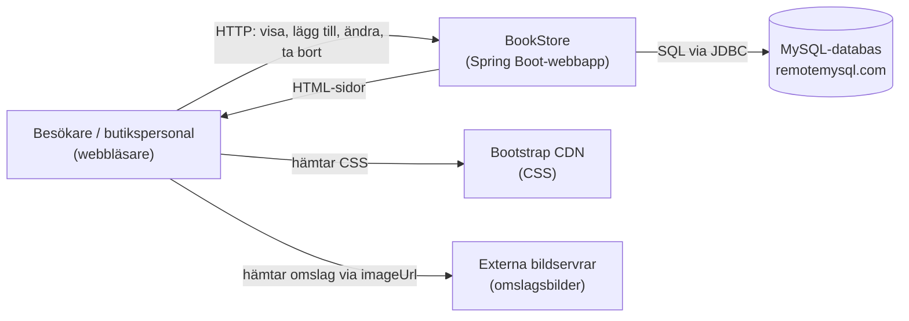
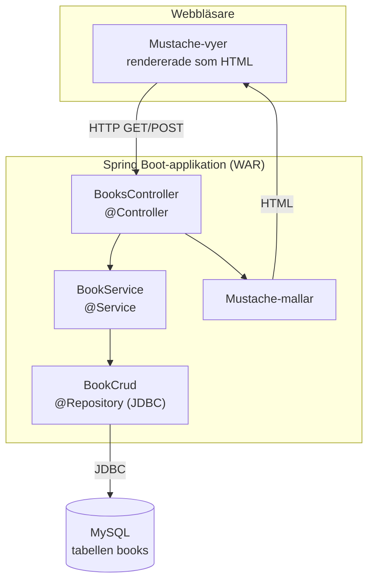
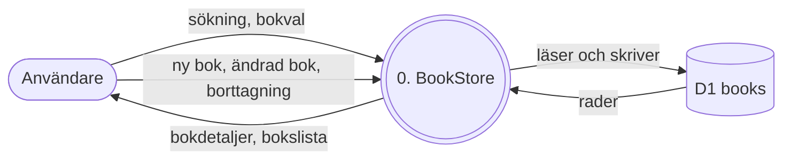
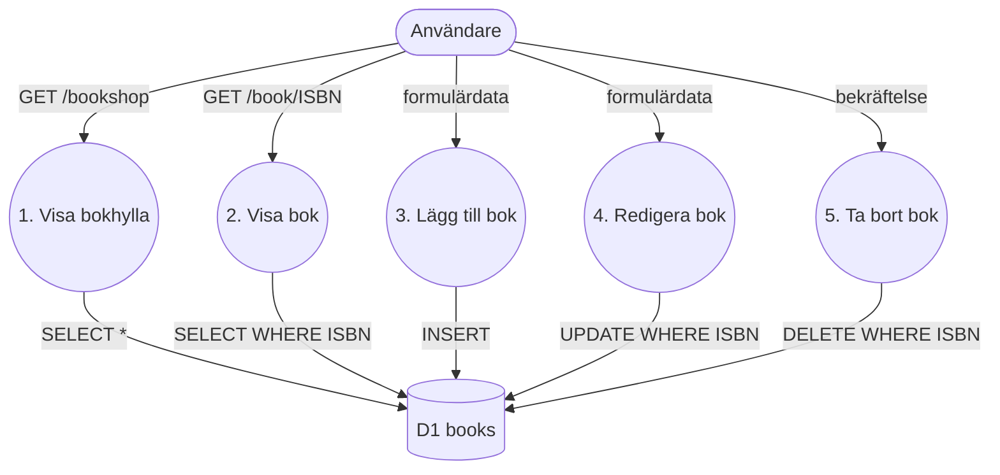
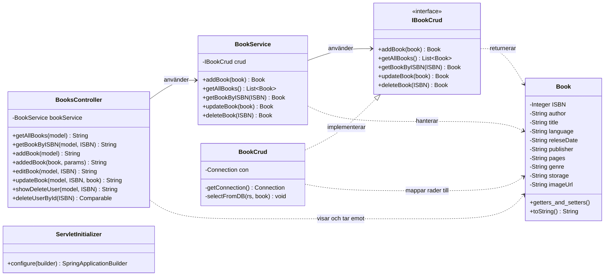
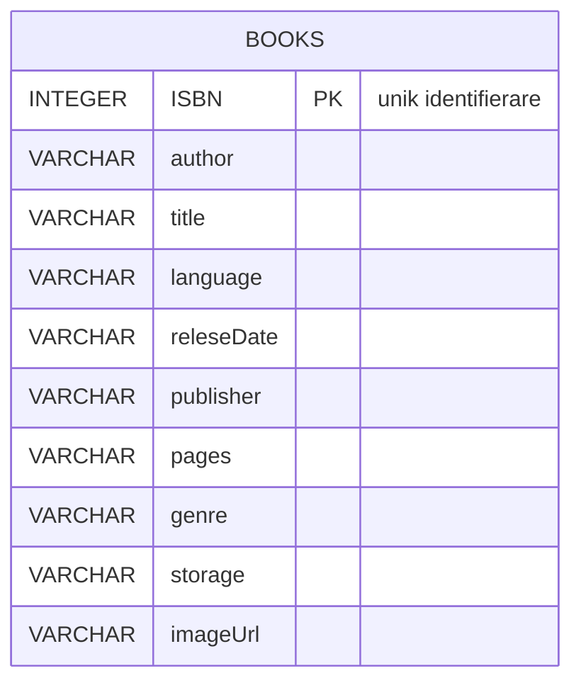
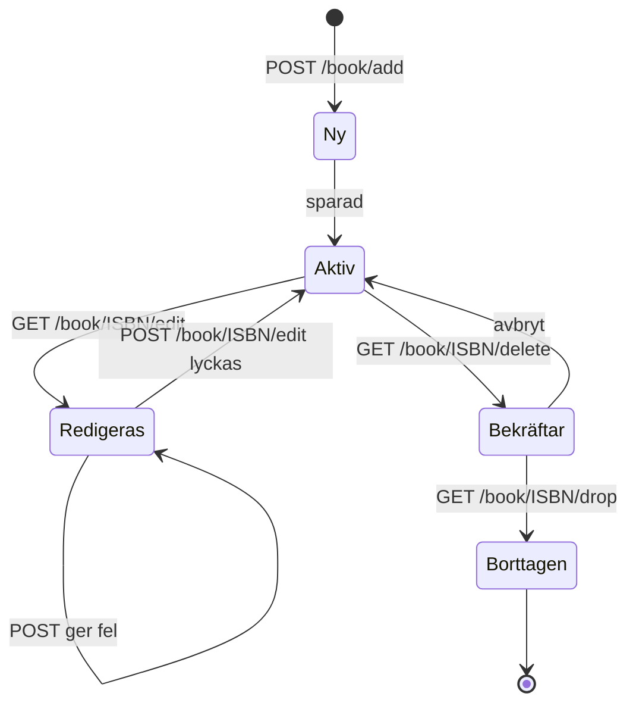
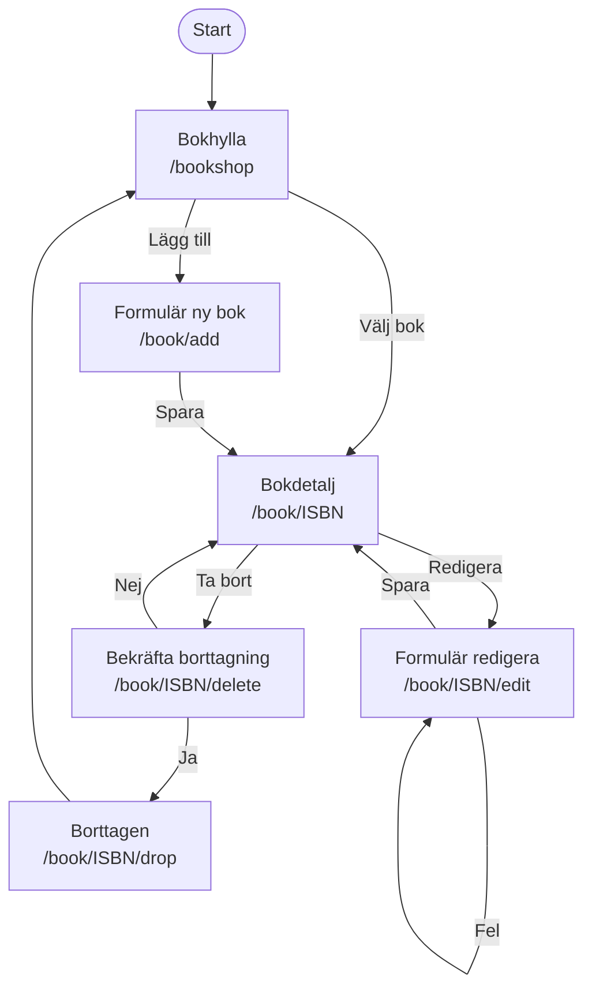
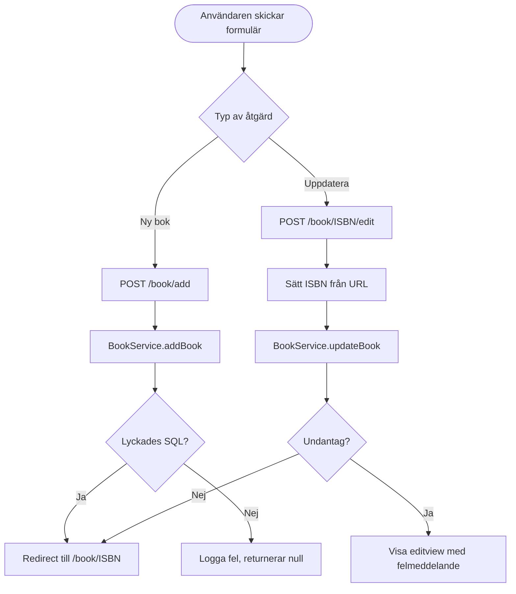

# BookStore

En webbaserad bokhandel där man kan bläddra bland böcker, se detaljer och lägga till, redigera eller ta bort böcker. Applikationen är byggd med Spring Boot, Mustache-mallar och en MySQL-databas.

## Innehåll

- [Teknikstack](#teknikstack)
- [Kom igång](#kom-igång)
- [Projektstruktur](#projektstruktur)
- [Sidor och rutter](#sidor-och-rutter)
- [Datamodell](#datamodell)
- [Systemkontextdiagram](#systemkontextdiagram-context-diagram)
- [Arkitekturdiagram](#arkitekturdiagram-c4-modellen)
- [Dataflödesdiagram (DFD)](#dataflödesdiagram-dfd)
- [UML-klassdiagram](#uml-klassdiagram)
- [ER-diagram](#er-diagram)
- [Tillståndsdiagram](#tillståndsdiagram-state-machine)
- [User flows](#user-flows-användarflöden)
- [Flödesschema: lägg till och uppdatera](#flödesschema-lägg-till-och-uppdatera-bok)
- [User stories](#user-stories-användarberättelser)
- [Wireframes](#wireframes)
- [Klickbar prototyp](#klickbar-prototyp)
- [Agila metoder](#agila-metoder-scrum--kanban)
- [CI/CD](#cicd-continuous-integration--continuous-delivery)
- [Kända problem](#kända-problem)

## Teknikstack

| Del | Teknik |
| --- | --- |
| Backend | Java 15, Spring Boot 2.3.4 (web, JDBC) |
| Vyer | Mustache-mallar, Bootstrap 4.5.2 |
| Databas | MySQL (fjärrdatabas hos remotemysql.com) |
| Byggverktyg | Maven (med wrapper `mvnw`) |
| Paketering | WAR |

## Kom igång

Krav: Java 15 och ett fungerande Maven-wrapper-stöd (eller Maven installerat).

```bash
cd TheFinalBookStore
./mvnw spring-boot:run      # startar på http://localhost:8081
```

Öppna sedan `http://localhost:8081/bookshop` i webbläsaren.

Databasanslutningen konfigureras med miljövariablerna `DB_URL`, `DB_USERNAME` och `DB_PASSWORD`, som läses i `src/main/resources/application.properties`.

## Projektstruktur

```
.
├── README.md
├── .idea/                          # IntelliJ-projektinställningar
└── TheFinalBookStore/
    ├── pom.xml
    ├── mvnw, mvnw.cmd
    └── src/main/
        ├── java/com/example/TheFinalBookStore/
        │   ├── TheFinalBookStoreApplication.java   # Startklass
        │   ├── configs/ServletInitializer.java     # Krävs för WAR-deploy
        │   ├── controllers/BooksController.java    # HTTP-rutter
        │   ├── services/BookService.java           # Affärslogik (delegerar)
        │   ├── repositorys/IBookCrud.java          # Gränssnitt för databasåtkomst
        │   ├── repositorys/BookCrud.java           # JDBC-implementation
        │   └── models/Book.java                    # Bok-modellen
        └── resources/
            ├── application.properties
            ├── templates/                          # Mustache-vyer
            └── images/                             # Logga och knappbilder
```

## Sidor och rutter

| Metod | Sökväg | Vy | Beskrivning |
| --- | --- | --- | --- |
| GET | `/bookshop` | `booksviewmysql` | Visar böcker. Sök med `q` och sortera med `sort` (`title`, `author`, `releseDate` eller `isbn`). |
| GET | `/book/{ISBN}` | `bookview` | Visar detaljer för en bok. |
| GET | `/book/add` | `addview` | Formulär för ny bok. |
| POST | `/book/add` | redirect | Sparar ny bok och går till bokens sida. |
| GET | `/book/{ISBN}/edit` | `editview` | Formulär för att redigera bok. |
| POST | `/book/{ISBN}/edit` | redirect eller `editview` | Uppdaterar bok. Visar fel vid undantag. |
| GET | `/book/{ISBN}/delete` | `bookDelete` | Bekräftelsesida för borttagning. |
| POST | `/book/{ISBN}/drop` | `changesSaved` | Tar bort boken. GET används inte för att ändra data. |

## Datamodell

Tabellen `books` har följande kolumner, och de matchar fälten i klassen `Book`:

| Kolumn | Typ i Java | Beskrivning |
| --- | --- | --- |
| ISBN | Integer | Primärnyckel, används i alla URL:er. |
| author | String | Författare. |
| title | String | Titel. |
| language | String | Språk. |
| releseDate | String | Utgivningsdatum (stavningen är som i koden). |
| publisher | String | Förlag. |
| pages | String | Antal sidor. |
| genre | String | Genre. |
| storage | String | Lagersaldo. |
| imageUrl | String | Länk till omslagsbild. |

## Systemkontextdiagram (Context Diagram)

Visar systemet som en svart låda och dess omgivning.



## Arkitekturdiagram (C4-modellen)

Nivå 2 (containers) och komponenter inne i Spring Boot-appen.



## Dataflödesdiagram (DFD)

### Nivå 0 (kontext)



### Nivå 1 (processer)



## UML-klassdiagram



## ER-diagram



Det finns bara en tabell. Böcker har inga relationer till andra tabeller, till exempel författare eller förlag, i nuvarande version. Författare och förlag lagras som text i samma rad.

## Tillståndsdiagram (State Machine)

Livscykeln för en bok i systemet:



## User flows (användarflöden)



## Flödesschema: lägg till och uppdatera bok



## User stories (användarberättelser)

1. **Som besökare** vill jag se alla böcker i en lista, så att jag kan bläddra i sortimentet.
   - *Acceptans:* Listan visar omslag, titel, författare och utgivningsdatum för varje bok.
2. **Som besökare** vill jag öppna en bok och se alla dess detaljer, så att jag kan avgöra om jag vill köpa den.
   - *Acceptans:* Sidan visar ISBN, författare, titel, språk, sidantal, genre, lagersaldo och utgivningsdatum.
3. **Som butikspersonal** vill jag lägga till en ny bok, så att den syns i sortimentet.
   - *Acceptans:* ISBN, författare och titel är obligatoriska. Efter sparning öppnas bokens sida.
4. **Som butikspersonal** vill jag redigera en befintlig bok, så att uppgifterna stämmer.
   - *Acceptans:* Formuläret är förifyllt med befintliga värden. Vid fel visas ett felmeddelande.
5. **Som butikspersonal** vill jag ta bort en bok, så att utgångna titlar inte syns.
   - *Acceptans:* Borttagning kräver en bekräftelse. Boken försvinner från listan.
6. **Som butikspersonal** vill jag se lagersaldot, så att jag vet när jag behöver beställa mer.
   - *Acceptans:* Lagersaldot visas på bokens sida och i listan.
7. **Som besökare** vill jag söka på ISBN, titel eller författare, så att jag snabbt hittar rätt bok.
   - *Acceptans:* Sökfältet filtrerar böcker efter ISBN, titel eller författare.

## Wireframes

Lågupplösta skisser av de viktigaste sidorna.

**Bokhylla (`/bookshop`)**

```
+----------------------------------------------------------+
| [LOGGA]                    [ + Lägg till bok ]  [Sök...] |
+----------------------------------------------------------+
| Hem / Alla böcker                                        |
+----------------------------------------------------------+
| +------------+  +------------+  +------------+           |
| | [omslag]   |  | [omslag]   |  | [omslag]   |           |
| | Titel      |  | Titel      |  | Titel      |           |
| | Författare |  | Författare |  | Författare |           |
| | Utg.datum  |  | Utg.datum  |  | Utg.datum  |           |
| | [ Select ] |  | [ Select ] |  | [ Select ] |           |
| +------------+  +------------+  +------------+           |
+----------------------------------------------------------+
```

**Bokdetalj (`/book/{ISBN}`)**

```
+----------------------------------------------------------+
| [LOGGA]                    [ + Lägg till bok ]  [Sök...] |
+----------------------------------------------------------+
| +-----------+   ISBN:       978-...                      |
| | [omslag]  |   Författare: ...                          |
| |           |   Titel:      ...                          |
| +-----------+   Språk:      ...                          |
|                 Sidor:      ...                          |
|                 Genre:      ...                          |
|                 Lager:      ...                          |
|                 Utgivning:  ...                          |
|                                                          |
|                 [ Redigera ]   [ Ta bort ]               |
+----------------------------------------------------------+
```

**Formulär: lägg till / redigera (`/book/add`, `/book/{ISBN}/edit`)**

```
+----------------------------------------------------------+
| [LOGGA]                                                  |
+----------------------------------------------------------+
| Ny bok / Redigera bok                                    |
|                                                          |
| ISBN*         [______________]                           |
| Författare*   [______________]                           |
| Titel*        [______________]                           |
| Språk         [______________]                           |
| Utgivning     [______________]                           |
| Förlag        [______________]                           |
| Sidor         [______________]                           |
| Genre         [______________]                           |
| Lager         [______________]                           |
| Bild-URL      [______________]                           |
|                                                          |
|                                      [ Spara ]           |
+----------------------------------------------------------+
```

**Bekräfta borttagning (`/book/{ISBN}/delete`)**

```
+----------------------------------------------------------+
| Vill du ta bort boken?                                   |
| "Titel" av Författare (ISBN ...)                         |
|                                                          |
|                       [ Avbryt ]     [ Ja, ta bort ]     |
+----------------------------------------------------------+
```

## Klickbar prototyp

Filen [`docs/prototype.html`](docs/prototype.html) är en klickbar prototyp av samma skärmar. Öppna den direkt i en webbläsare. Navigeringen fungerar som i den riktiga appen, men data är exempeldata och sparas inte.

## Agila metoder (Scrum / Kanban)

Projektet bör arbeta med en Kanban-tavla. Den passar bra för ett litet projekt med löpande arbete.

| Kolumn | Innebörd |
| --- | --- |
| Backlog | Alla user stories som inte är påbörjade. |
| Redo | Prioriterade och förberedda för utveckling. |
| Pågående | Max två kort per person. |
| Granskning | Kod och vyer granskas, testas manuellt. |
| Klar | Mergad till `main`. |

Om gruppen vill ha Scrum:
- **Sprintlängd:** 1 vecka.
- **Sprintplanering:** prioritera user stories från backloggen.
- **Daily:** kort statusgenomgång.
- **Sprintgranskning:** visa klickbar prototyp och körbar version.
- **Retrospektiv:** vad fungerade och vad ska ändras.

## CI/CD (Continuous Integration / Continuous Delivery)

Det finns ännu ingen pipeline i repot. Förslag på GitHub Actions som bygger och testar varje push till `main`:

```yaml
# .github/workflows/ci.yml
name: CI

on:
  push:
    branches: [ main ]
  pull_request:

jobs:
  build:
    runs-on: ubuntu-latest
    defaults:
      run:
        working-directory: TheFinalBookStore
    steps:
      - uses: actions/checkout@v4
      - uses: actions/setup-java@v4
        with:
          distribution: temurin
          java-version: '15'
          cache: maven
      - name: Bygg och testa
        run: ./mvnw -B verify
      - name: Spara WAR-filen
        uses: actions/upload-artifact@v4
        with:
          name: bookstore-war
          path: TheFinalBookStore/target/*.war
```

Continuous Delivery kan läggas till som ett extra steg som deployar WAR-filen till en server, men det kräver att databasuppgifterna hanteras som hemligheter i GitHub.

## Kända problem

- Applikationen kräver en tillgänglig MySQL-databas och att `DB_URL`, `DB_USERNAME` och `DB_PASSWORD` är satta.
